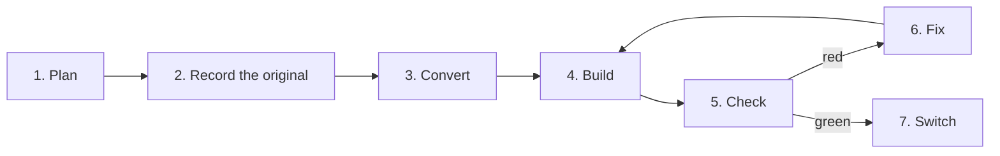

<p align="center">
  <picture>
    <source media="(prefers-color-scheme: dark)" srcset="docs/assets/migrate-icon-on-dark.svg">
    
  </picture>
</p>

<h1 align="center">Markless Migrate</h1>

<p align="center">
  <strong>Move any web app to Markless, one page at a time.</strong><br />
  Your coding agent rewrites each page. A checker proves it matches the original before it goes live.
</p>

<p align="center">
  <a href="https://markless.dev/start/migrate">Docs</a> ·
  <a href="#quick-start">Quick start</a> ·
  <a href="#how-it-works">How it works</a> ·
  <a href="#ports-so-far">Ports so far</a>
</p>

> Early preview. It changes often and isn't on npm yet.

## What it looks like

```bash
markless-migrate plan  --old https://old.example.com --source ../old-app   # what the old app has and uses
markless-migrate check --old https://old.example.com --new http://localhost:5173 --open
markless-migrate switch /pricing                                            # only once /pricing is green
```

`check` opens the old page and the new one side by side in a real browser and reports every difference, with what each side showed and the file and line on each side, in a form your agent can fix. Every report leads with the slowest first click on each side: `First interaction: old 40 ms → new 230 ms (4x CPU)`.

## What makes it different

**Proof, not a promise.** A page switches over only when its check is green. Check compares what people see, what screen readers get, what search engines get, how fast it loads and how every control behaves when it's used, with the clock, randomness and the page's data frozen so both sides show the same thing.

**From any framework, with nothing of the old one left.** Sites built with Next.js, Remix, Angular, VitePress, Docusaurus, htmx and Alpine.js are among the ports so far. The old framework's runtime never ships: a guard fails the build if it does. Widgets from UI libraries such as Radix, Base UI and React Aria are rebuilt once as small Markless parts and reused on every site.

**Read from the source, not guessed from the screen.** Migrate reads the old app's code to know what each element is and what each handler does, instead of guessing from how the page looks.

**Ship before you're done.** Switched pages go to the new app and every other page stays on the old one, behind a local proxy or generated Vercel or Nitro routing. A big app moves bit by bit without ever shipping a broken page.

**Your agent, your login.** Migrate drives Claude Code, Codex, Cursor, Gemini CLI, GitHub Copilot CLI or opencode on the login you already have. It never calls a model or holds an API key itself.

## How it works



**1. Plan: take stock of the old app.** `plan` lists the old site's routes from its sitemaps, `robots.txt`, feeds, a crawl of its links and, when you pass `--source`, its own source code. For each route it notes the SEO tags, assets, locales and caching. It also writes a usage inventory: what each page actually uses in the browser, such as an htmx attribute, a theme toggle, or a Radix dialog and the props it is given, with the file and line where it lives. These files land in `.migrate/` as JSON your agent can read.

**2. Record the original.** The old pages are loaded in a real browser and recorded: the settled page and what each control reveals (menus, dialogs, tab panels). Each recording is stored under a key made from the old page's HTML and the recorder's own code, so a page is recorded again only when it or the recorder changes. `check --data record` also saves the responses each old page fetched, so they can be replayed later.

**3. Convert: write the Markless app.** `convert` turns each recorded page into a Markless `.tsrx` page. It leaves the old framework's code out, writes regions several pages share (a header, a sidebar) once as components, and copies static assets byte for byte. To know what each element is, it reads the old source, not just the markup: JavaScript and TypeScript are parsed with [yuku](https://www.npmjs.com/package/yuku), CSS with [yuku-css](https://github.com/thejackshelton/yuku-css). Widgets from UI libraries (Radix, Base UI, React Aria and others) are driven by **parts**: small Markless ports of each library's behaviour, written once and reused across sites. What is left, the site's own client code, is the part your agent writes.

**4. Build.** The port is built for production like any Markless app.

**5. Check: compare old and new side by side.** `check` opens each route on both apps in a real browser and compares what people see, what screen readers get, what search engines get, how fast the page loads and how each control behaves when it is used. The clock, randomness, timezone and locale are frozen. Data a page fetches from other sites is fetched once and given to both sides, and with `--data replay` the old app's recorded responses are served to both apps, so both pages show the same content. Every difference is reported with what each side showed and, when the source is known, the file and line on each side. Results go to `.migrate/report.json` and a visual `.migrate/report.html`.

**6. Fix, one route at a time.** Your agent reads the report, fixes the route and checks it again. `run` does this unattended: it drives your agent's own command line (Claude Code, Codex, Gemini CLI, Cursor, GitHub Copilot CLI or opencode) on the login it already has, route by route, and moves on when a route is still red after its attempts. `fix` is the same loop for a person: it converts, builds and checks only the routes you name.

**7. Switch, route by route.** `switch` moves a route to Markless only when its last check is green. While you migrate, a proxy (local) or generated Vercel or Nitro routing (production) sends switched routes to the new app and every other route to the old one, so the port can ship before it is finished.

**Only what changed runs again.** Each stage keys its work by content. With `check --reuse`, a route's result is kept under a key of what that route ships: its HTML, the code of every module it can run, the files its HTML names, the old page it was compared with, and the checker's own version. When none of those changed, the result is reused. The CI pipeline (`.github/workflows/pipeline.yml`) keys plan, recording, convert and build the same way, so a stage whose inputs did not change is read back from the run that made it, and only routes whose shipped code changed are checked again.

## What check compares

| Dimension | In plain words |
| --- | --- |
| `http`, `auth` | Status codes, redirects, and which signed-in roles may see the page |
| `rendered`, `visual` | The accessibility tree, the visible text, and full-page screenshots, including hover, focus and other states |
| `css`, `assets` | Computed styles of each visible element, traced back to the old CSS rule; images and the exact font files used |
| `seo`, `i18n`, `data` | Meta tags and structured data; language, text direction and date formats; feeds, sitemaps and JSON endpoints |
| `a11y` | axe-core results, landmarks, focus order and keyboard paths through menus, dialogs, tabs and other widgets |
| `behaviour` | Interactions explored on the old page and replayed on the new one: what appears, what is stored, what is requested |
| `network` | Each request the page makes, in the browser and while the server renders it |
| `weight`, `load` | JavaScript run at load, and page load as PageSpeed Insights measures it |
| `responsiveness` | How soon each control answers its first use and each link shows the next page, on a desktop and on a phone with the CPU slowed 4x |
| `motion`, `navigation` | Transitions and animations; and whether a page reached by clicking a link inside the app matches a fresh load of it |

Every report leads with the slowest first interaction on each side, for example `First interaction: old 40 ms → new 230 ms (4x CPU)`. The full rules are in [docs/check.md](docs/check.md).

**Journeys and probes.** Check explores the old page by using its controls, records those steps as journeys, and replays them on the new page. Every interactive element of the old page must be used by at least one journey, or the route stays red. Widget probes then drive one control of each kind through a fixed sequence (open, point, choose, Escape, Tab, drag) on both pages at once, comparing focus, state attributes and what is open after every step.

## Architecture

The code is in `src/`, with library parts in `parts/`. Each folder does one job:

| Module | What it does |
| --- | --- |
| `plan/` | Builds the inventory: each route it finds, where it was found, and the order to migrate in |
| `source/` | Reads the old app's code: its framework, routes (from Next.js, Remix, SvelteKit and others, plus Django, Rails, Laravel and WordPress), auth guards, API clients and which handlers write |
| `usage/` | The usage inventory, and the checks each used behaviour must pass (`.migrate/obligations.json`) |
| `library/` | Finds each library the old app imports, decides whether to port the parts it uses or keep the library as it is, and holds certified ports tested against the real library |
| `convert/` | Records the old pages and writes the Markless app; `record-key.ts` makes the content keys recordings are kept under |
| `parts/` | Markless ports of widget behaviour from Radix, Base UI, React Aria, Qwik UI and others, shared across sites |
| `ledger/` | Maps each element the old source wires to a handler (an `onClick`, a library's Close) to what answers it in the port, and fails when nothing does |
| `check/` | The comparison engine: loading, freezing, journeys, probes, timing, recorded data and the reports |
| `client/` | The guards that keep other frameworks' runtimes out of the port |
| `cache/` | Plans CDN caching for each route from the old site's evidence, writes it into the app, and checks the deployment |
| `switch/` | The list of switched routes, the local proxy, and the Vercel and Nitro routing |
| `run/`, `agents/`, `mcp/` | Drives your agent's command line, installs the migration skill, and serves the MCP tools your agent calls |
| `embed/`, `upgrade/`, `dev/` | Third-party embeds; measurements after the migration; the quick fix loop |

`scripts/pipeline.ts` computes the stage keys for the CI pipeline. `status.ts` tracks each route's progress.

This tool never calls a model or holds an API key. The only model involved is your own agent, signed in with its own login.

## What it guarantees, and what it doesn't

**No other framework's runtime ships.** The port must not ship React, Vue, Svelte, Qwik, htmx, Alpine, jQuery or the other runtimes the guard knows. `guard build` reads the build's scripts and fails when one defines another framework's runtime, and `guard page` fails when a new page runs one. It recognises a runtime by what its code defines, so a page that only mentions htmx in its text passes. What the old pages used of that framework is implemented in Markless instead. Libraries that only need JavaScript (Chart.js, Leaflet, Monaco) may be kept as they are, and each one kept is listed.

**Static assets are the same bytes.** CSS, fonts, images, SVG and media are copied byte for byte. `guard page` loads each old page and fails when an asset it loads is missing on the new page or has other bytes. `run` applies both guards to every route it checks.

**What counts as green.** A route is green when each dimension check compared matches, or the difference is accepted. A partial run (`--route`, `--changed`) is never reported as an overall green. A route that could not be fully compared, for example because a bot wall blocked it, stays red. The migration is done only when every planned route is green and switched without force.

**Accepted differences.** Some differences are accepted automatically because the check has evidence no visitor can see them. One example is the old framework's own route announcer missing while the rest of the accessibility tree matches. Each is labelled with its rule and evidence. Anything else stays red until it is fixed or a person accepts it with `accept <id> --reason ...`. Agents cannot accept: the skill tells them not to, the MCP server has no accept tool, and `run` refuses it.

**What it doesn't catch yet.** The clock is frozen in the browser. On the server it is frozen only with `--server-clock` and the request recorder. Server requests are recorded only for Node servers. Writes (form posts and other non-GET requests) are held back and compared unsent unless both apps run on your machine or are marked as staging, but writes the server makes on its own while handling a request cannot be held back. The lab page-load numbers can differ from PageSpeed Insights by 10 points or more. The known gaps are listed in [docs/plan.md](docs/plan.md).

## Quick start

You need Node 24.11 or newer and [pnpm](https://pnpm.io). The package is not on npm yet, so run it from a clone:

```bash
git clone https://github.com/compiled-run/markless-migrate && cd markless-migrate
pnpm install && pnpm browsers
alias markless-migrate="node $PWD/src/cli.ts"
```

Create a Markless app with `npm create markless@latest`. Start both apps (below, the old one on port 3000 and the new one on 5173; use your own ports). Then, from the new app's folder, where Markless Migrate keeps its state in `.migrate/`:

```bash
markless-migrate setup                                                  # add the migration skill and MCP server to your agent
markless-migrate plan --old http://localhost:3000 --source ../old-app   # inventory the old app
markless-migrate convert --old http://localhost:3000 --source ../old-app
markless-migrate check --old http://localhost:3000 --new http://localhost:5173 --open
markless-migrate run --agent claude --old http://localhost:3000 --new http://localhost:5173 --all
markless-migrate switch /about && markless-migrate status
```

`setup --undo` puts back every file `setup` changed. `markless-migrate help` lists the commands and their options.

## Ports so far

These are work-in-progress ports of public sites and open-source apps, made to test the tool. They are not official ports and are not endorsed by those projects. Each port's log records every attempt and what is still red.

| Port | Original | What it tests |
| --- | --- | --- |
| [shadcn-ui](examples/shadcn-ui-LOG.md) | ui.shadcn.com (Next.js 16, React 19) | The full pipeline: pages are written by `convert`, not by hand |
| [docusaurus](examples/docusaurus-markless-LOG.md) | docusaurus.io, three pages | A docs site, with the other routes left on the original |
| [vite-dev](examples/VITE-DEV-LOG.md) | vite.dev homepage (VitePress) | One route switched behind a front door |
| [htmx-org](examples/htmx-org-LOG.md), [alpinejs-dev](examples/alpinejs-dev-LOG.md) | htmx.org, alpinejs.dev | Porting from the live site alone, without its source |
| [next-dashboard](examples/next-dashboard-LOG.md) | Next.js Learn dashboard | Sign-in, a Postgres database, create, edit and delete |
| [remix-notes](examples/remix-notes-LOG.md) | Remix Indie Stack | Cookie sessions and a SQLite database |
| [realworld](examples/realworld-markless-LOG.md) | RealWorld "Conduit" (Angular) | Request-for-request network contracts against one backend |
| [hn-graphql](examples/hn-graphql-LOG.md), [hn-rsc](examples/hn-rsc-LOG.md), [react-hn](examples/react-hn-LOG.md) | Three Hacker News clones | GraphQL, React Server Components, and live Firebase data |
| [tanstack-query](examples/tanstack-query-LOG.md) | TanStack Router kitchen sink | Dependent queries, prefetching and clicks faster than the network |
| [shadcn-admin](examples/shadcn-admin-LOG.md), [ag-grid](examples/ag-grid-LOG.md) | shadcn-admin, Devtron's AG Grid panel | Porting the library parts an app uses |
| [vite-site](examples/MIGRATION-LOG.md) | A small Vite test site | A whole migration done by Codex through `run` |

Before and after numbers for the ports that are deployed are at [markless.dev/start/migrate](https://markless.dev/start/migrate).

## Reference

| Topic | Covers |
| --- | --- |
| [Command reference](docs/commands.md) | Every command, what `plan`, `check`, `setup` and `run` write, and the PageSpeed Insights key |
| [Checking a port](docs/check.md) | Each dimension in full, responsiveness, widget probes, sign-in, recorded data, writes, accepted differences, command-line tools |
| [Converting pages](docs/convert.md) | The usage inventory and guards, `convert`, the `fix` loop, library decisions, certified ports, embeds, `upgrade` |
| [Caching, switching and deploying](docs/deploy.md) | CDN caching rules, `switch`, the proxy, production routing, the demo |
| [Development](docs/development.md) | Running the tests, the fixtures, CI and branch protection |
| [Plan and known gaps](docs/plan.md) | The design, and what a green report does not promise yet |
| [Notes](docs/notes/) | Agents, caching, hosts, hard problems and prior art |

## License

MIT. The fixtures include the Inter font under the SIL Open Font License (`fixtures/INTER-LICENSE.txt`).
