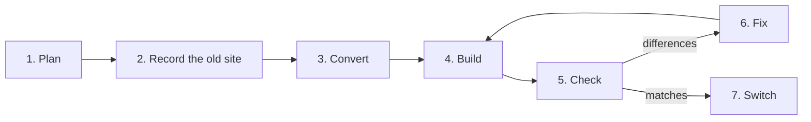

<p align="center">
  <picture>
    <source media="(prefers-color-scheme: dark)" srcset="docs/assets/migrate-icon-on-dark.svg">
    
  </picture>
</p>

<h1 align="center">Markless Migrate</h1>

<p align="center">
  <strong>Move any web app to Markless, one page at a time.</strong><br />
  Your coding agent rewrites each page. A checker proves it matches the original before it goes live.
</p>

<p align="center">
  <a href="https://markless.dev/start/migrate">Docs</a> ·
  <a href="#quick-start">Quick start</a> ·
  <a href="#how-it-works">How it works</a> ·
  <a href="#ports-so-far">Ports so far</a>
</p>

> Early preview. It changes often and isn't on npm yet.

## What it looks like

```bash
markless-migrate plan  --old https://old.example.com --source ../old-app   # what the old app has and uses
markless-migrate check --old https://old.example.com --new http://localhost:5173 --open
markless-migrate switch /pricing                                            # only once /pricing is green
```

`check` opens the old page and the new one side by side in a real browser and reports every difference, with what each side showed and the file and line on each side, in a form your agent can fix. Every report leads with the slowest first click on each side: `First interaction: old 40 ms → new 230 ms (4x CPU)`.

## What makes it different

**Proof, not a promise.** A page switches over only when its check is green. Check compares what people see, what screen readers get, what search engines get, how fast it loads and how every control behaves when it's used, with the clock, randomness and the page's data frozen so both sides show the same thing.

**From any framework, with nothing of the old one left.** Sites built with Next.js, Remix, Angular, VitePress, Docusaurus, htmx and Alpine.js are among the ports so far. The old framework's runtime never ships: a guard fails the build if it does. Widgets from UI libraries such as Radix, Base UI and React Aria are rebuilt once as small Markless parts and reused on every site.

**Read from the source, not guessed from the screen.** Migrate reads the old app's code to know what each element is and what each handler does, instead of guessing from how the page looks.

**Ship before you're done.** Switched pages go to the new app and every other page stays on the old one, behind a local proxy or generated Vercel or Nitro routing. A big app moves bit by bit without ever shipping a broken page.

**Your agent, your login.** Migrate drives Claude Code, Codex, Cursor, Gemini CLI, GitHub Copilot CLI or opencode on the login you already have. It never calls a model or holds an API key itself.

## How it works



**1. Plan: list what the old app has.** `plan` finds every page of the old site, from its sitemap, its links and, if you give it the code, its routes. For each page it notes the title and meta tags, the files it loads and what it uses in the browser, like a dark-mode toggle or a Radix dialog, with the file and line it comes from. It all goes into `.migrate/` as JSON your agent can read.

**2. Record the old site.** Each old page is opened in a real browser and saved: how it looks once it has loaded, and what each button, menu and tab opens. A page is only recorded again when the page itself changes.

**3. Convert: write the Markless version.** `convert` turns each recorded page into a Markless page. It reads the old code, not just the screen, to know what each element is. Things several pages share, like a header or a sidebar, are written once. Images, fonts and CSS are copied as they are. Widgets from UI libraries like Radix, Base UI and React Aria are handled by **parts**: small Markless versions of each widget, written once and reused on every site. Your agent writes whatever is left: the site's own code.

**4. Build.** The new app is built like any Markless app.

**5. Check: compare old and new side by side.** `check` opens each page on both apps in a real browser and compares them. The clock, random numbers and the page's data are the same on both sides, so any difference is a real one. Each difference says what each side showed and, when it can, the file and line on each side. You get `.migrate/report.json` for your agent and `.migrate/report.html` with screenshots for you.

**6. Fix, one page at a time.** Your agent reads the report, fixes the page and checks again. `run` does this on its own for every page, using your agent's command line. `fix` does it for the pages you name.

**7. Switch, page by page.** `switch` sends a page to the new app only once its check matches. Every other page keeps going to the old app, through a local proxy or generated Vercel or Nitro routing, so you can ship before the whole app is moved.

**Only what changed runs again.** Each step saves its results under a fingerprint of its inputs. If a page's code and the old page it's compared with haven't changed, its last result is reused, so after a small fix only the affected pages are checked again.

## What check compares

| What | In plain words |
| --- | --- |
| `http`, `auth` | Status codes, redirects, and who has to be signed in to see the page |
| `rendered`, `visual` | What screen readers get, the visible text, and screenshots, including hover and focus |
| `css`, `assets` | The styles on each visible element, and the exact images and font files |
| `seo`, `i18n`, `data` | Meta tags for search engines; language, text direction and date formats; feeds and sitemaps |
| `a11y` | Accessibility checks, focus order, and using menus, dialogs and tabs with the keyboard |
| `behaviour` | Using each control on the old page and doing the same on the new one: what appears, what's saved, what's requested |
| `network` | Every request the page makes |
| `weight`, `load` | How much JavaScript runs when the page loads, and how fast it loads |
| `responsiveness` | How fast each button answers its first click and each link shows the next page, on a desktop and on a slowed-down phone |
| `motion`, `navigation` | Animations, and whether a page reached by clicking a link looks the same as loading it directly |

**How controls get tested.** Check clicks, types and presses keys through the old page, saves those steps, and does exactly the same on the new page. Every control on the old page has to be used at least once, or the page doesn't pass. The full rules are in [docs/check.md](docs/check.md).

## How the code is organised

The code is in `src/`, with the library parts in `parts/`:

| Folder | What it does |
| --- | --- |
| `plan/` | Finds the old site's pages and the order to move them in |
| `source/` | Reads the old app's code: its framework, routes, sign-in rules, and which handlers change data |
| `usage/` | Lists what each page uses in the browser, and what has to be tested for each |
| `library/` | Finds the libraries the old app uses, and decides whether to rebuild the parts it uses or keep the library |
| `convert/` | Records the old pages and writes the Markless app |
| `parts/` | Markless versions of widgets from Radix, Base UI, React Aria, Qwik UI and others |
| `ledger/` | Checks that everything the old code made clickable still does something in the new app |
| `check/` | Compares old and new and writes the reports |
| `client/` | Makes sure no other framework's code ships in the new app |
| `cache/` | Sets up CDN caching for each page, based on how the old site caches it |
| `switch/` | Tracks which pages have moved, and the proxy and routing that send visitors to the right app |
| `run/`, `agents/`, `mcp/` | Runs your agent, installs its migration instructions, and gives it tools to call |
| `embed/`, `upgrade/`, `dev/` | YouTube videos, tweets and other embeds; measurements after the move; the quick fix loop |

## What it promises, and what it doesn't

**None of the old framework ships.** The new app can't include React, Vue, Svelte, Qwik, htmx, Alpine, jQuery or other framework code. The build fails if it does. Plain JavaScript libraries like Chart.js or Leaflet can stay, and each one that stays is listed.

**Images, fonts and CSS are the exact same files.** A page fails if anything it loads is missing or different.

**What counts as passing.** A page passes when everything check compares matches, or a person has accepted the difference with a reason. A page that couldn't be fully checked, for example because a bot blocker got in the way, doesn't pass. Your agent can't accept differences, only you can.

**Not covered yet.** Some server-side things can't be frozen everywhere yet, like the server's clock, and requests the server makes while it builds the page are only recorded for Node servers. Load-speed numbers from a local run can be 10 or more points off from Google's PageSpeed Insights. The full list is in [docs/plan.md](docs/plan.md).

## Quick start

You need Node 24.11 or newer and [pnpm](https://pnpm.io). It's not on npm yet, so run it from a clone:

```bash
git clone https://github.com/compiled-run/markless-migrate && cd markless-migrate
pnpm install && pnpm browsers
alias markless-migrate="node $PWD/src/cli.ts"
```

Make a new Markless app with `npm create markless@latest`, start both apps (here the old one is on port 3000 and the new one on 5173), and from the new app's folder run:

```bash
markless-migrate setup                                                  # teach your agent how to migrate
markless-migrate plan --old http://localhost:3000 --source ../old-app   # list what the old app has
markless-migrate convert --old http://localhost:3000 --source ../old-app
markless-migrate check --old http://localhost:3000 --new http://localhost:5173 --open
markless-migrate run --agent claude --old http://localhost:3000 --new http://localhost:5173 --all
markless-migrate switch /about && markless-migrate status
```

`setup --undo` puts back everything `setup` changed. `markless-migrate help` lists every command.

## Ports so far

Unofficial, work-in-progress ports of public sites and open-source apps, made to test the tool. Each one has a log of every attempt and what still differs.

| Port | Original | What it tests |
| --- | --- | --- |
| [shadcn-ui](examples/shadcn-ui-LOG.md) | ui.shadcn.com (Next.js 16, React 19) | The full pipeline: pages are written by `convert`, not by hand |
| [docusaurus](examples/docusaurus-markless-LOG.md) | docusaurus.io, three pages | A docs site, with the other routes left on the original |
| [vite-dev](examples/VITE-DEV-LOG.md) | vite.dev homepage (VitePress) | One page moved while the rest stays on the old site |
| [htmx-org](examples/htmx-org-LOG.md), [alpinejs-dev](examples/alpinejs-dev-LOG.md) | htmx.org, alpinejs.dev | Porting from the live site alone, without its source |
| [next-dashboard](examples/next-dashboard-LOG.md) | Next.js Learn dashboard | Sign-in, a Postgres database, create, edit and delete |
| [remix-notes](examples/remix-notes-LOG.md) | Remix Indie Stack | Cookie sessions and a SQLite database |
| [realworld](examples/realworld-markless-LOG.md) | RealWorld "Conduit" (Angular) | Both apps making the same requests to one backend |
| [hn-graphql](examples/hn-graphql-LOG.md), [hn-rsc](examples/hn-rsc-LOG.md), [react-hn](examples/react-hn-LOG.md) | Three Hacker News clones | GraphQL, React Server Components, and live Firebase data |
| [tanstack-query](examples/tanstack-query-LOG.md) | TanStack Router kitchen sink | Dependent queries, prefetching and clicks faster than the network |
| [shadcn-admin](examples/shadcn-admin-LOG.md), [ag-grid](examples/ag-grid-LOG.md) | shadcn-admin, Devtron's AG Grid panel | Porting the library parts an app uses |
| [vite-site](examples/MIGRATION-LOG.md) | A small Vite test site | A whole migration done by Codex through `run` |

Before and after numbers for the ports that are deployed are at [markless.dev/start/migrate](https://markless.dev/start/migrate).

## Reference

| Topic | Covers |
| --- | --- |
| [Command reference](docs/commands.md) | Every command, what `plan`, `check`, `setup` and `run` write, and the PageSpeed Insights key |
| [Checking a port](docs/check.md) | Each dimension in full, responsiveness, widget probes, sign-in, recorded data, writes, accepted differences, command-line tools |
| [Converting pages](docs/convert.md) | The usage inventory and guards, `convert`, the `fix` loop, library decisions, certified ports, embeds, `upgrade` |
| [Caching, switching and deploying](docs/deploy.md) | CDN caching rules, `switch`, the proxy, production routing, the demo |
| [Development](docs/development.md) | Running the tests, the fixtures, CI and branch protection |
| [Plan and known gaps](docs/plan.md) | The design, and what a green report does not promise yet |
| [Notes](docs/notes/) | Agents, caching, hosts, hard problems and prior art |

## License

MIT. The fixtures include the Inter font under the SIL Open Font License (`fixtures/INTER-LICENSE.txt`).
